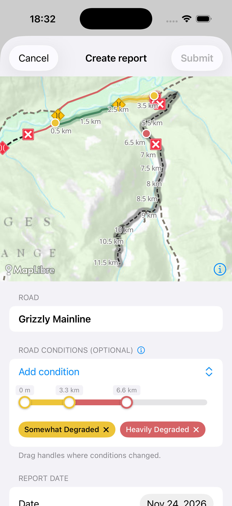
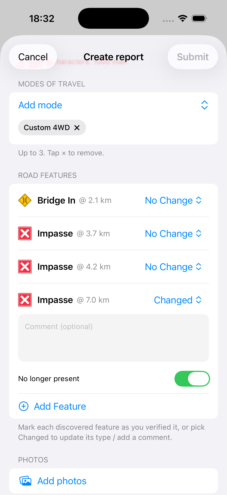
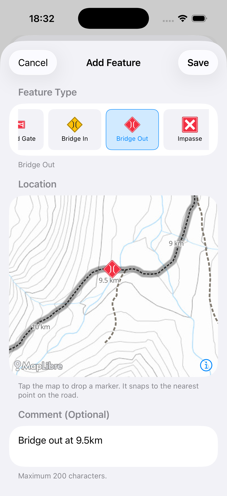
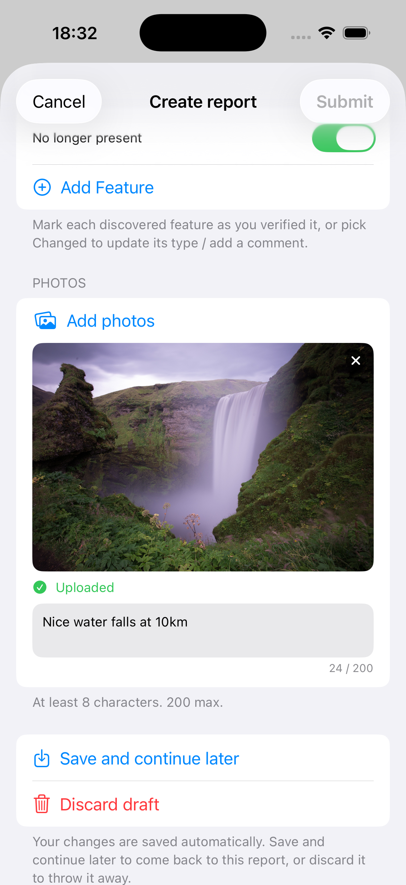

# BackroadStatus SDK

A mobile SDK for integrating with [backroadstatus.com](https://backroadstatus.com) a crowdsourced road-conditions service for backroads around BC, Alberta and The Yukon. The SDK handles OAuth, condition bulletins, road geometry, offline caching, and ships a drop-in views so that your users can file a report in a few taps without you building the form.

## iOS

|||
|--- |---|
|||
|||


The SDK is published as one Swift package with several library products. Add only the ones you need.

| Product | What it is                                                                                                                                                                     | Depends on |
| --- |--------------------------------------------------------------------------------------------------------------------------------------------------------------------------------| --- |
| `BackroadStatusCore` | OAuth (PKCE via AppAuth-iOS), bulletin / road API client, geometry cache, submission queue.                                                                                    | — |
| `BackroadStatusMapKit` | Vendor-neutral `MapProvider` protocol, coordinate / bounding-box types, canonical layer IDs.                                                                                   | Core |
| `BackroadStatusComposerUI` | Drop-in SwiftUI composer (`BackroadStatusReportView`) and pending-bulletins list (`BackroadStatusPendingBulletinsView`). Speaks only to `MapProvider` and is map-SDK agnostic. | Core, MapKit |
| `BackroadStatusMapLibreUI` | `MapProvider` adapter over MapLibre Native's `MLNMapView` + convenience helpers.                                                                                               | ComposerUI, MapLibre |
| `BackroadStatusMapboxUI` | `MapProvider` adapter over Mapbox Maps SDK v11's `MapView`.                                                                                                                    | ComposerUI, MapboxMaps |

Pick **one** map-SDK adapter (`MapLibreUI` or `MapboxUI`) based on what the rest of your app already uses. The composer doesn't care which.

### Requirements

- iOS 16+
- Swift 5.9 / Xcode 15+
- A registered OAuth client on backroadstatus.com (see [Server setup](#server-setup))
- One of: MapLibre Native 7+, or Mapbox Maps SDK iOS 11+ (with an access token)

### Install (Swift Package Manager)

In Xcode: **File → Add Package Dependencies…** and paste:

```
https://github.com/francisbaileyh/BackroadStatus-SDK.git
```

Pick the products you need. A typical MapLibre-based integration takes:

- `BackroadStatusCore`
- `BackroadStatusMapKit`
- `BackroadStatusComposerUI`
- `BackroadStatusMapLibreUI`

For a Mapbox-based integration, swap `BackroadStatusMapLibreUI` for `BackroadStatusMapboxUI`.

## Server setup

Before the SDK will do anything, register an OAuth application:

1. See: [our developer docs](https://backroadstatus.com/developer/docs/rest-api.html) for more details.

Then register the redirect URI's scheme as a URL type in your app target: **Target → Info → URL Types → +**, with URL Scheme set to the scheme portion of your redirect URI.

## Configure the SDK

```swift
import SwiftUI
import BackroadStatusCore

@main
struct YourApp: App {
    init() {
        BackroadStatus.configure(
            clientId: "<your-client-id>",
            redirectUri: URL(string: "com.yourcompany.yourapp://oauth/callback")!,
            issuer: URL(string: "https://backroadstatus.com")!
        )
    }

    var body: some Scene { WindowGroup { ContentView() } }
}
```

## Sign in

The composer gates itself and it will prompt for sign-in to backroadstatus.com when the user first tries to submit a report. For most integrations you don't need an explicit sign-in button. But, if you do want one:

```swift
import BackroadStatusCore

Button("Sign in") {
    Task {
        try? await BackroadStatus.shared.signIn(presenting: rootViewController())
        let me = try? await BackroadStatus.shared.me()
        print("Signed in as \(me?.email ?? "?")")
    }
}

Button("Sign out") {
    BackroadStatus.shared.signOut()
}
```

Tokens are persisted in the Keychain (`kSecAttrAccessibleAfterFirstUnlock`) and refreshed automatically on 401.

## Present the report composer

The composer takes a road ID, a map style URL, and a view-builder that returns your map-SDK adapter. The adapter wires its native map view up to the composer via the `MapProvider` protocol.

### MapLibre

```swift
import SwiftUI
import BackroadStatusCore
import BackroadStatusComposerUI
import BackroadStatusMapLibreUI

struct YourMapScreen: View {
    @State private var composingFor: TappedRoad?

    var body: some View {
        // ... your main map view that sets `composingFor` on road tap ...
        .sheet(item: $composingFor) { road in
            BackroadStatusReportView(
                roadId: road.id,
                mapStyleURL: yourStyleURL,
                roadName: road.name
            ) { binding in
                MapLibreComposerMap(binding: binding)
            }
        }
    }
}
```

### Mapbox

The Mapbox adapter assumes you've configured the Mapbox access token before any `MapView` is created. Do it in your app via `init()`:

```swift
import MapboxMaps

@main
struct YourApp: App {
    init() {
        MapboxOptions.accessToken = "<your-mapbox-public-token>"
        BackroadStatus.configure(/* ... */)
    }
    // ...
}
```

Then present the composer:

```swift
import SwiftUI
import BackroadStatusCore
import BackroadStatusComposerUI
import BackroadStatusMapboxUI

.sheet(item: $composingFor) { road in
    BackroadStatusReportView(
        roadId: road.id,
        mapStyleURL: yourStyleURL,
        roadName: road.name
    ) { binding in
        MapboxComposerMap(binding: binding)
    }
}
```

That's it. The composer handles sign-in prompting, road geometry fetch (with offline-cache fallback), condition sliders, add-feature picker, photos, vehicle categories, submit, and offline queuing.

### Show the pending-bulletins list

Bulletins submitted offline sit in a local queue and retry automatically. `BackroadStatusPendingBulletinsView` surfaces that queue so the user can edit, retry, or discard any entry. It takes the same `map:` builder pattern because Edit re-opens the composer with the saved draft.

```swift
import BackroadStatusComposerUI
import BackroadStatusMapLibreUI // or BackroadStatusMapboxUI

NavigationLink("Pending bulletins") {
    BackroadStatusPendingBulletinsView(mapStyleURL: yourStyleURL) { binding in
        MapLibreComposerMap(binding: binding)
        // or: MapboxComposerMap(binding: binding)
    }
}
```

### Required style layers

The composer and the condition-color helper look for these layer IDs in whatever style you pass as `mapStyleURL`. The simplest starting point is to use the reference style the BackroadStatus tile server emits and layer it under your base map:

| Layer ID | Purpose |
| --- | --- |
| `roads-NOMINAL` | Line layer, roads rated nominal. |
| `roads-DEGRADED` | Line layer, roads rated degraded. |
| `roads-HEAVILY_DEGRADED` | Line layer, heavily degraded. |
| `roads-IMPASSABLE` | Line layer, impassable. |
| `roads-fallback` | Line layer, roads without a known condition. |
| `road-features-circles` | Circle layer for feature POIs (gates, washouts, bridges…). |
| `road-features-icons` | Symbol layer for the same POIs, iconified. |

The source serving these layers is `backroadstatus-roads` (source-layer `roads`).

### Align your main map's palette with the composer

Call this when your main map's style finishes loading so your map and the composer render roads with the same canonical colors regardless of what palette your style ships with:

```swift
// MapLibre
import BackroadStatusMapKit
import BackroadStatusMapLibreUI

func mapView(_ mapView: MLNMapView, didFinishLoading style: MLNStyle) {
    BackroadStatusMapLayers.applyCanonicalConditionColors(style: style)
}

// Mapbox
import BackroadStatusMapboxUI

mapView.mapboxMap.onStyleLoaded.observe { _ in
    BackroadStatusMapLayers.applyCanonicalConditionColors(map: mapView.mapboxMap)
}
```

Both overloads iterate the same `BackroadStatusMapLayers.conditionLayerMapping` so the palette is identical across the two SDKs.

### Offline Road Data

For roads the user will tap while offline, you'll need to add the following integration to ensure that the data is available offline:

```swift
try await BackroadStatus.shared.downloadGeometry(bounds: regionBounds) { progress in
    // UI updates — fires off the main thread
}
```

`BackroadStatusReportView` automatically consults the offline cache before hitting the network, so the composer works for any road inside a region you've prefetched.

## Android
Coming soon!

## License

Licensed under the Apache License, Version 2.0. See [LICENSE](LICENSE) for the full text.